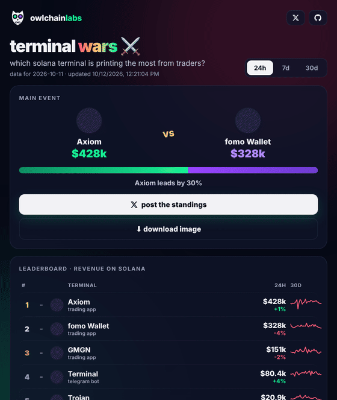

# ⚔️ terminal wars

which solana trading terminal is printing the most from traders?

**live: [wars.owlchainlabs.xyz](https://wars.owlchainlabs.xyz)**



- daily revenue leaderboard of solana trading terminals and bots (axiom, gmgn, photon, trojan, ...)
- solana chain only, so multi-chain terminals are compared fairly
- 24h, 7d and 30d views, rank changes, 30 day trend
- one click to post the standings (tags the #1 terminal) or download them as an image
- updates every 3 hours

## how it works

a github action runs every 3 hours, pulls daily revenue per protocol from the free [defillama](https://defillama.com) api,
keeps only the solana part and writes `public/data.json` plus a share image `public/og.png`. the page in `public/` is plain html that reads that file. no server, no keys.

```bash
npm install
node scripts/update.mjs   # refresh public/data.json and public/og.png (node 20+)
```

## license

MIT · built in public by [@OwlChainLabs](https://x.com/OwlChainLabs)
